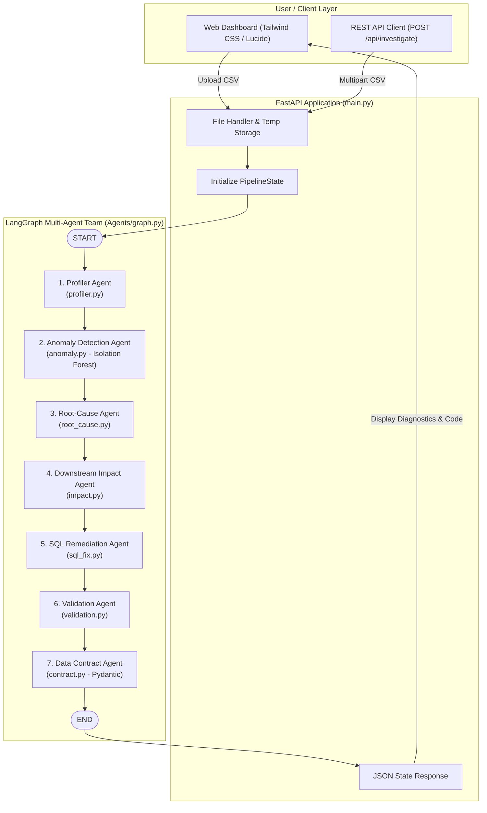
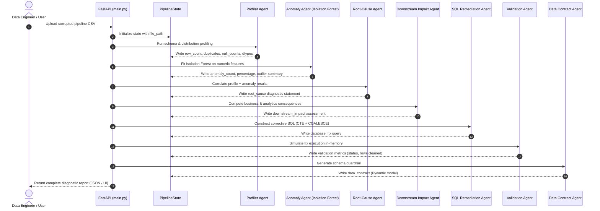

# 🔍 Data Pipeline Detective

> **Autonomous multi-agent system for real-time data pipeline anomaly detection, root-cause diagnostics, impact analysis, and self-healing remediations.**

[](https://www.python.org/)
[](https://fastapi.tiangolo.com)
[](https://github.com/langchain-ai/langgraph)
[](https://scikit-learn.org/)
[](https://tailwindcss.com/)

---

## 📖 Table of Contents
- [Overview](#-overview)
- [Key Features](#-key-features)
- [System Architecture](#-system-architecture)
  - [Workflow Diagram](#workflow-diagram)
  - [Agent Interaction Sequence](#agent-interaction-sequence)
- [Multi-Agent Roster](#-multi-agent-roster)
- [Technology Stack](#-technology-stack)
- [Repository Structure](#-repository-structure)
- [Step-by-Step Setup & Installation](#-step-by-step-setup--installation)
  - [Prerequisites](#prerequisites)
  - [1. Clone Repository](#1-clone-repository)
  - [2. Create & Activate Virtual Environment](#2-create--activate-virtual-environment)
  - [3. Install Dependencies](#3-install-dependencies)
  - [4. Run the Application](#4-run-the-application)
- [Usage Guide](#-usage-guide)
  - [Web Interface](#web-interface)
  - [REST API Endpoint](#rest-api-endpoint)
- [Roadmap & Evaluation](#-roadmap--evaluation)
- [License](#-license)

---

## 🌟 Overview

Data pipelines break silently. Upstream schema changes, duplicated ingestion batches, null injections, and statistical outliers cascade downstream, resulting in corrupted analytics dashboards, degraded machine learning models, and broken automated business operations.

**Data Pipeline Detective** is an intelligent, autonomous diagnostic platform powered by a stateful **LangGraph** multi-agent pipeline and a **FastAPI** backend. When a CSV data payload or pipeline log is submitted, a coordinated team of 7 specialized agents inspects the data, detects structural and statistical anomalies, synthesizes root causes, translates technical errors into business risk, writes production-ready SQL remediation scripts, validates the fixes in memory, and generates preventative Pydantic data contracts to enforce schema guardrails.

---

## ⚡ Key Features

- **Automated Data Profiling**: Instantly extracts row counts, duplicate records, null counts, column data types, and five-number statistical summaries.
- **Unsupervised ML Anomaly Detection**: Uses Scikit-learn's **Isolation Forest** algorithm on numerical attributes to catch subtle multi-dimensional outliers that rule-based checks miss.
- **Root-Cause Reasoning Engine**: Analyzes combined profiling metrics and ML outlier patterns to isolate exact points of failure (e.g., ingestion deduplication failures, upstream null-injection).
- **Downstream Business Impact Translation**: Translates technical bugs into executive-level risk reports detailing analytics distortion, machine learning prediction drop-offs, and operational/financial threats.
- **Automated SQL Remediation**: Generates corrective SQL scripts featuring Common Table Expressions (CTE) with window functions (`ROW_NUMBER() OVER (PARTITION BY ...)`) for deduplication and `COALESCE` statements for null imputation.
- **Simulation & Validation Loop**: Executes a virtualized correction pass in memory, testing and reporting the exact number of duplicates removed and null values resolved before changes are deployed.
- **Preventative Pydantic Data Contracts**: Generates strongly-typed Python Pydantic models with `extra = 'forbid'` and type annotations to reject invalid payloads at the ingestion boundary.
- **Interactive Dark-Mode Dashboard**: Sleek, modern web interface with real-time progress indicators, diagnostic metric badges, and one-click code copy tools.

---

## 🏗️ System Architecture

Data Pipeline Detective is organized into three core layers:
1. **Presentation Layer**: A responsive web dashboard rendered with Tailwind CSS and Lucide icons.
2. **API & Service Layer**: A FastAPI ASGI server managing file uploads, temporary file sandboxes, and workflow execution.
3. **Agent Orchestration Layer**: A compiled **LangGraph** state graph executing a sequential pipeline across a shared `PipelineState`.

### Workflow Diagram



### Agent Interaction Sequence



---

## 🤖 Multi-Agent Roster

| Agent | Module | Description & Role |
| :--- | :--- | :--- |
| **Profiler Agent** | `Agents/profiler.py` | Performs initial schema validation, detects duplicates, measures null rates per column, and generates statistical summaries. |
| **Anomaly Agent** | `Agents/anomaly.py` | Implements an unsupervised **Isolation Forest** (`contamination=0.05`) to flag non-linear statistical anomalies and abnormal records. |
| **Root-Cause Agent** | `Agents/root_cause.py` | Synthesizes metric findings into concrete technical diagnoses (e.g. missing deduplication step, upstream null-injection, drift). |
| **Downstream Impact Agent** | `Agents/impact.py` | Assesses the business risk, reporting risks to dashboards (overcounting), ML model degradation (missing features), and billing disruptions. |
| **SQL Fix Agent** | `Agents/sql_fix.py` | Writes custom SQL queries incorporating window-partition deduplication CTEs and `COALESCE` defaults. |
| **Validation Agent** | `Agents/validation.py` | Simulates the data repair on the active dataset to verify resolution and confirm row reconciliation. |
| **Data Contract Agent** | `Agents/contract.py` | Emits a preventative Pydantic model with strict field typing and `extra = 'forbid'` to prevent future pipeline poisoning. |

---

## 🛠️ Technology Stack

| Category | Technology | Purpose |
| :--- | :--- | :--- |
| **Language** | [Python 3.10+](https://www.python.org/) | Core language runtime |
| **Agent Orchestration** | [LangGraph](https://github.com/langchain-ai/langgraph) | Cyclic and acyclic multi-agent graph orchestration |
| **Web Framework** | [FastAPI](https://fastapi.tiangolo.com/) | High-performance asynchronous REST API backend |
| **ASGI Server** | [Uvicorn](https://www.uvicorn.org/) | Production-ready ASGI web server |
| **Data Processing** | [Pandas](https://pandas.pydata.org/) | Data profiling, manipulation, and cleansing |
| **Machine Learning** | [Scikit-learn](https://scikit-learn.org/) | Isolation Forest unsupervised anomaly detection |
| **Data Contracts** | [Pydantic](https://docs.pydantic.dev/) | Strongly typed schema generation and data validation |
| **Frontend UI** | HTML5, JavaScript, [Tailwind CSS](https://tailwindcss.com/) | Modern, dark-mode diagnostic dashboard |
| **Iconography** | [Lucide Icons](https://lucide.dev/) | Clean, semantic UI icons |

---

## 📁 Repository Structure

```text
DataPipelineDetective/
├── Agents/                        # LangGraph Multi-Agent Module
│   ├── __init__.py                # Agents package initialization
│   ├── anomaly.py                 # Outlier detection using Isolation Forest
│   ├── contract.py                # Pydantic data contract generator
│   ├── graph.py                   # LangGraph workflow builder and compiler
│   ├── impact.py                  # Downstream business impact analyzer
│   ├── profiler.py                # Schema, null, and duplicate profiler
│   ├── root_cause.py              # Root-cause diagnostic agent
│   ├── sql_fix.py                 # Corrective SQL remediation generator
│   ├── state.py                   # Shared PipelineState TypedDict definition
│   └── validation.py              # In-memory remediation validation agent
├── evaluation/                    # Pipeline benchmarking and evaluation
│   ├── evaluation_agent.py        # Automated test harness for agent accuracy
│   └── test_cases/                # Sample test datasets and edge cases
├── frontend/                      # Static dashboard assets
│   └── index.html                 # Complete single-page dashboard UI
├── .env                           # Environment variables configuration
├── .gitignore                     # Git ignore rules
├── main.py                        # FastAPI entrypoint & API routing
├── requirements.txt               # Project dependencies
└── README.md                      # Project documentation
```

---

## 🚀 Step-by-Step Setup & Installation

### Prerequisites

Ensure you have the following installed on your machine:
- **Python 3.10** or higher: Verify with `python --version`
- **Git**: Verify with `git --version`
- **pip** package manager

---

### 1. Clone Repository

Clone the project repository to your local machine:

```bash
git clone https://github.com/PJ-21-code/DataPipelineDetective.git
cd DataPipelineDetective
```

---

### 2. Create & Activate Virtual Environment

Create an isolated virtual environment to manage dependencies:

#### Windows (PowerShell):
```powershell
python -m venv .venv
.\.venv\Scripts\Activate.ps1
```
*(If script execution is disabled on PowerShell, run `Set-ExecutionPolicy -ExecutionPolicy RemoteSigned -Scope CurrentUser`)*

#### Windows (Command Prompt):
```cmd
python -m venv .venv
.\.venv\Scripts\activate.bat
```

#### macOS / Linux:
```bash
python3 -m venv .venv
source .venv/bin/activate
```

---

### 3. Install Dependencies

Install all required packages from `requirements.txt`:

```bash
pip install --upgrade pip
pip install -r requirements.txt
```

---

### 4. Run the Application

Start the FastAPI application using Uvicorn:

```bash
uvicorn main:app --reload --host 0.0.0.0 --port 8000
```

Once running, you will see output similar to:
```text
INFO:     Uvicorn running on http://0.0.0.0:8000 (Press CTRL+C to quit)
INFO:     Started reloader process [...]
INFO:     Application startup complete.
```

Open your browser and navigate to:
👉 **[http://localhost:8000](http://localhost:8000)**

---

## 💻 Usage Guide

### Web Interface

1. Open **[http://localhost:8000](http://localhost:8000)** in your browser.
2. Under **Upload Corrupted CSV Pipeline Log**, select a `.csv` dataset file.
3. Click **Dispatch Agents**.
4. The system will process the dataset through the 7-node LangGraph team and present:
   - **Root-Cause Diagnosis Card**: Detailed explanation of detected flaws.
   - **Downstream Business Impact Card**: Actionable summary of business risks.
   - **Metric Snapshot Bar**: Total records, duplicate count, ML outliers, and validation status.
   - **Proposed SQL Remediation**: Synthesized SQL query ready to copy and run against your data warehouse.
   - **Pydantic Prevention Contract**: Copy-pasteable Python schema with strict bounds to insert at ingestion.

---

### REST API Endpoint

You can also integrate Data Pipeline Detective directly into your CI/CD or orchestrator (e.g., Airflow, Prefect, Dagster).

#### Endpoint: `POST /api/investigate`

**Request:** `multipart/form-data` with key `file` containing a `.csv` file.

#### Example using `cURL`:
```bash
curl -X POST "http://localhost:8000/api/investigate" \
  -H "accept: application/json" \
  -H "Content-Type: multipart/form-data" \
  -F "file=@sample_data.csv"
```

#### Example Response Body:
```json
{
  "file_path": "C:\\Users\\...\\tmp12345.csv",
  "profile": {
    "row_count": 1000,
    "duplicate_rows": 45,
    "null_counts": {
      "user_id": 0,
      "amount": 250,
      "timestamp": 0
    },
    "dtypes": {
      "user_id": "int64",
      "amount": "float64",
      "timestamp": "object"
    },
    "numeric_summary": { ... }
  },
  "anomaly": {
    "anomaly_count": 12,
    "percentage": 1.2,
    "message": "Detected 12 statistical outliers (1.2% of dataset)."
  },
  "root_cause": "Found 45 duplicate rows, indicating missing deduplication steps during ingestion. Column 'amount' has 25.0% missing values, signaling upstream schema drift or null-injection. Detected 12 statistical outliers (1.2% of dataset).",
  "downstream_impact": "• **Analytics Distortion**: 45 duplicate rows (4.5% of dataset) detected...\n• **Data Completeness Risk**: Critical columns (amount) suffer from high null rates...",
  "database_fix": "WITH ranked_data AS (\n    SELECT *,\n           ROW_NUMBER() OVER(PARTITION BY user_id ORDER BY (SELECT NULL)) as rn\n    FROM raw_pipeline_data\n)\nSELECT user_id, COALESCE(amount, 'DEFAULT_VALUE') AS amount, timestamp\nFROM ranked_data\nWHERE rn = 1;",
  "validation": {
    "status": "SUCCESS",
    "initial_rows": 1000,
    "final_rows": 955,
    "duplicates_removed": 45,
    "remaining_nulls": 0,
    "message": "Validation passed successfully. Removed 45 duplicates and sanitized null records."
  },
  "data_contract": "from pydantic import BaseModel\nfrom typing import Optional\nfrom datetime import datetime\n\nclass IngestionDataContract(BaseModel):\n    user_id: int\n    amount: Optional[float]\n    timestamp: str\n\n    class Config:\n        extra = 'forbid'  # Blocks upstream schema drift"
}
```

---

## 🔮 Roadmap & Evaluation

- [x] **Core Multi-Agent Architecture**: 7-stage sequential LangGraph workflow.
- [x] **Isolation Forest Outlier Detection**: Unsupervised multi-attribute anomaly isolation.
- [x] **Automated SQL Remediation**: CTE window functions and null coalesce clauses.
- [x] **Interactive Dashboard**: Modern dark-slate UI with live metrics and code copying.
- [ ] **Evaluation Suite (`evaluation/evaluation_agent.py`)**: Automated scoring harness for synthetic dirty datasets (missing values, schema changes, spikes).
- [ ] **Data Warehouse Connectors**: Direct connectors for Snowflake, BigQuery, and Databricks.
- [ ] **dbt Model Generation**: Export remediation directly as dbt `.sql` models and `.yml` schema tests.

---

