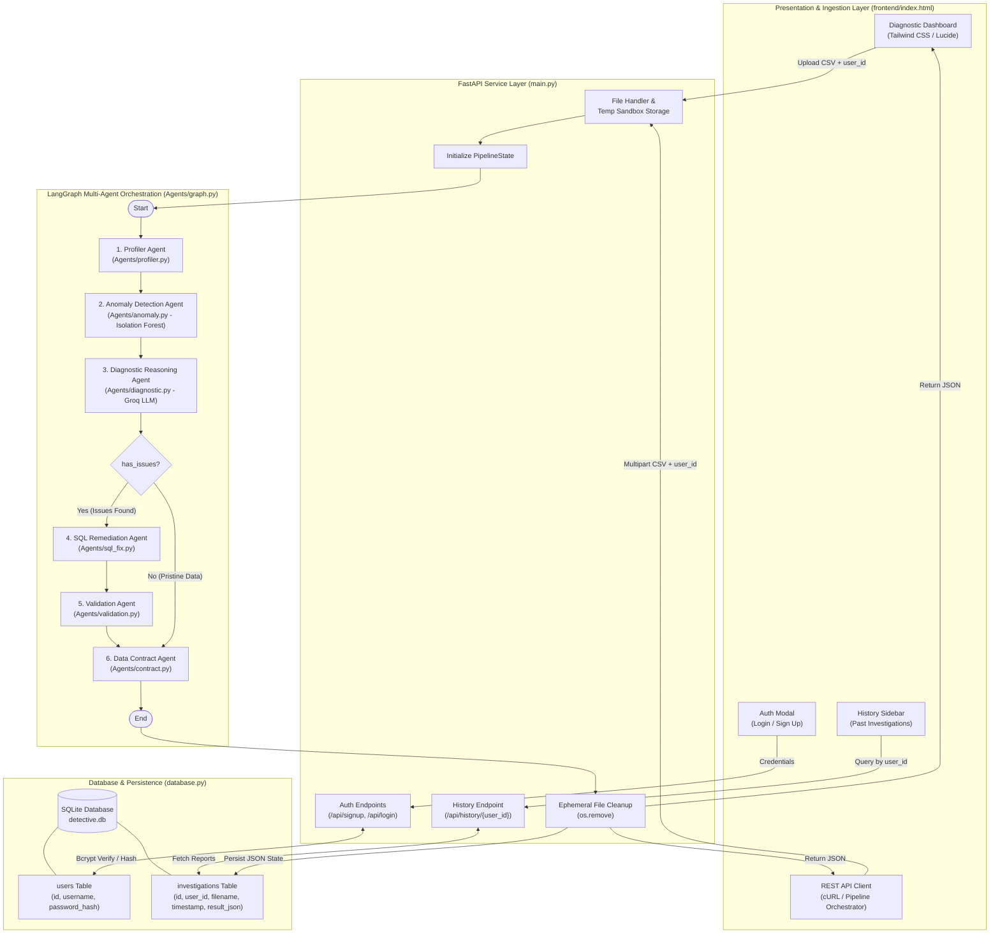

# 🔍 Data Pipeline Detective

> **Autonomous multi-agent system powered by LangGraph and Groq for real-time data pipeline anomaly detection, cognitive root-cause diagnostics, impact analysis, self-healing SQL remediation, and preventative data contracts—featuring secure bcrypt authentication and SQLite historical persistence.**

[](https://www.python.org/)
[](https://fastapi.tiangolo.com)
[](https://github.com/langchain-ai/langgraph)
[](https://groq.com/)
[](https://www.sqlite.org/)
[](https://github.com/pyca/bcrypt)
[](https://scikit-learn.org/)
[](https://tailwindcss.com/)

---

## 📖 Table of Contents
- [Overview](#-overview)
- [Key Features](#-key-features)
- [System Architecture](#-system-architecture)
  - [Workflow Diagram](#workflow-diagram)
  - [Agent & Database Interaction Sequence](#agent--database-interaction-sequence)
- [Multi-Agent Roster](#-multi-agent-roster)
- [Database Architecture & Security](#-database-architecture--security)
  - [Relational Schema Design](#relational-schema-design)
  - [Bcrypt Authentication & Password Hashing](#bcrypt-authentication--password-hashing)
  - [Privacy-by-Design & Ephemeral Sandbox Lifecycle](#privacy-by-design--ephemeral-sandbox-lifecycle)
- [Technology Stack](#-technology-stack)
- [Repository Structure](#-repository-structure)
  - [Diagrammatic Architecture](#diagrammatic-architecture)
  - [Directory Tree](#directory-tree)
- [Step-by-Step Setup & Installation](#-step-by-step-setup--installation)
  - [Prerequisites](#prerequisites)
  - [1. Clone Repository](#1-clone-repository)
  - [2. Create & Activate Virtual Environment](#2-create--activate-virtual-environment)
  - [3. Install Dependencies](#3-install-dependencies)
  - [4. Configure Environment Variables](#4-configure-environment-variables)
  - [5. Run the Application](#5-run-the-application)
- [Usage Guide](#-usage-guide)
  - [1. User Authentication (Login & Signup)](#1-user-authentication-login--signup)
  - [2. Diagnostic Dashboard & History Sidebar](#2-diagnostic-dashboard--history-sidebar)
  - [3. REST API Endpoints](#3-rest-api-endpoints)
- [Roadmap & Evaluation](#-roadmap--evaluation)
- [License](#-license)

---

## 🌟 Overview

Modern data pipelines fail silently. Inadvertent upstream schema mutations, duplicated batch ingestion windows, unexpected null injections, and subtle distribution shifts cascade into downstream data lakes. The consequences are severe: poisoned analytics dashboards, silent ML feature drift, inaccurate financial calculations, and broken automated decision engines.

**Data Pipeline Detective** is an autonomous, cognitive diagnostic and self-healing platform designed to monitor, triage, repair, and persist data pipeline audit histories before corruption infects downstream consumers. 

Powered by **LangGraph** multi-agent orchestration, **Groq high-speed LLM inference**, **Scikit-learn Isolation Forest**, **SQLite persistence**, and a **FastAPI** backend secured with **Bcrypt**, the system operates as an intelligent on-call data reliability engineer:
1. **Profiles & Audits**: Inspects incoming CSV payloads for schema fidelity, duplicate records, null frequency, and statistical distributions.
2. **Detects Unsupervised Outliers**: Discovers multi-dimensional statistical anomalies using Isolation Forests that deterministic rules miss.
3. **Reasoning Engine (Groq LLM)**: Synthesizes technical profile metrics and anomaly patterns into human-readable engineering root-cause analyses and executive-level business risk assessments.
4. **Conditional Self-Healing**: Dynamically evaluates pipeline health (`has_issues`). If anomalies or corruption are detected, it generates targeted SQL remediation scripts (using window functions and `COALESCE`) and simulates the repair in-memory to validate data recovery.
5. **Smart Bypass**: If the dataset is pristine, the system automatically bypasses remediation and validation nodes, saving compute and eliminating false alarms.
6. **Preventative Enforcement**: Generates strict, type-annotated **Pydantic Data Contracts** (`extra = 'forbid'`) to enforce schema guardrails at ingestion boundaries.
7. **Secure Authentication & Historical Auditing**: Encrypts user credentials with **Bcrypt** and records every diagnostic assessment to an embedded **SQLite** database (`detective.db`), enabling team members to instantly review historical pipeline failures while maintaining **Zero Raw Data Retention** for maximum compliance and privacy.

---

## ⚡ Key Features

- **Automated Data Profiling**: Instantly computes dataset dimensions, duplicate row counts, per-column null percentages, inferred data types, and five-number numerical distribution summaries.
- **Unsupervised ML Anomaly Detection**: Trains an in-memory Scikit-learn **Isolation Forest** (`contamination=0.05`) across numerical attributes to isolate multivariate outliers and distribution drift.
- **Cognitive LLM Diagnostics (Groq & Llama 3)**: Leverages `ChatGroq` (`langchain-groq`) for near-instantaneous reasoning that synthesizes technical anomalies into:
  - **Root-Cause Diagnoses**: Precise engineering failure hypotheses (e.g., failed deduplication, unhandled upstream null bursts, schema drift).
  - **Downstream Impact Assessments**: Concrete business risk translations (dashboard inflation, machine learning feature degradation, billing discrepancy risks).
- **Intelligent Conditional Routing**: Employs LangGraph conditional edge routing (`route_after_diagnostic`). Pristine datasets skip straight to contract generation, while degraded datasets trigger automated remediation and validation pipelines.
- **Self-Healing SQL Remediation**: Produces deterministic SQL queries utilizing Common Table Expressions (CTEs) with Window Functions (`ROW_NUMBER() OVER(PARTITION BY ... ORDER BY (SELECT NULL))`) for partition-based deduplication and `COALESCE` statements for missing value imputation.
- **In-Memory Simulation & Validation**: Simulates data cleansing transformations in memory using Pandas to guarantee the proposed fix reconciles records, removes duplicates, and sanitizes null values before warehouse deployment.
- **Preventative Pydantic Data Contracts**: Automatically derives strongly-typed Pydantic validation schemas with `extra = 'forbid'` and optionality flags to reject ill-formed data payloads at the API or streaming ingestion layer.
- **Secure Bcrypt Authentication**: Salted, one-way password hashing (truncated to 72 bytes per bcrypt standard) protecting user accounts and isolating investigation records across team members.
- **Persistent Investigation History (SQLite)**: Automatically persists all diagnostic results (profile, anomaly count, Groq diagnostic text, generated SQL fixes, Pydantic contracts) to [`detective.db`](file:///c:/Users/pranj/DataPipelineDetective/detective.db) via [`database.py`](file:///c:/Users/pranj/DataPipelineDetective/database.py) for instant review.
- **Zero Raw Data Retention (Privacy-by-Design)**: Ephemeral sandbox file lifecycle guarantees raw pipeline datasets are never persisted to disk or database—only sanitized diagnostic metadata and generated code are preserved.
- **Interactive History Sidebar**: Sidebar navigation in the UI allowing users to switch between past investigations without re-running compute or re-uploading files.
- **Graceful Fallback Mechanism**: Built-in resilience ensures that even if external LLM APIs experience rate-limiting or network timeouts, deterministic heuristic diagnostics are provided without breaking the pipeline.

---

## 🏗️ System Architecture

Data Pipeline Detective is engineered as a layered, stateful multi-agent system:

1. **Presentation Layer**: A single-page web dashboard ([`frontend/index.html`](file:///c:/Users/pranj/DataPipelineDetective/frontend/index.html)) built with Tailwind CSS, Lucide Icons, Marked.js, and vanilla JavaScript. Features authentication modals (Sign Up / Log In), an investigation history sidebar with instant historical report switching, drag-and-drop CSV upload, live status spinners, and one-click copy buttons for SQL fixes and Pydantic contracts.
2. **API & Service Layer**: A high-performance **FastAPI** ASGI server ([`main.py`](file:///c:/Users/pranj/DataPipelineDetective/main.py)) running on **Uvicorn**. Exposes endpoints for user registration (`/api/signup`), authentication (`/api/login`), multipart investigation dispatch with user attribution (`/api/investigate`), and historical record querying (`/api/history/{user_id}`). Manages ephemeral temporary sandbox files and guarantees cleanup.
3. **Database & Security Layer**: A dedicated persistence module ([`database.py`](file:///c:/Users/pranj/DataPipelineDetective/database.py)) backed by an embedded **SQLite** database ([`detective.db`](file:///c:/Users/pranj/DataPipelineDetective/detective.db)). Manages relational tables for `users` and `investigations`, enforcing foreign key integrity, bcrypt password hashing with salt generation, and JSON payload serialization/deserialization.
4. **Agent Orchestration Layer**: A compiled **LangGraph** `StateGraph` ([`Agents/graph.py`](file:///c:/Users/pranj/DataPipelineDetective/Agents/graph.py)) passing a centralized `PipelineState` ([`Agents/state.py`](file:///c:/Users/pranj/DataPipelineDetective/Agents/state.py)) through modular agent nodes with dynamic conditional branching (`route_after_diagnostic`).
5. **Cognitive & Machine Learning Layer**:
   - **Groq LLM Engine**: Fast inference via `ChatGroq` (`langchain-groq`) powering deep diagnostic reasoning and business impact translation.
   - **Isolation Forest**: Scikit-learn unsupervised model identifying multi-dimensional numeric outliers.
   - **Pandas Data Engine**: In-memory profiling, metric aggregation, and validation simulation.

---

### Workflow Diagram



---

### Agent & Database Interaction Sequence

```mermaid
sequenceDiagram
    autonumber
    actor User as Data Engineer / Client
    participant UI as Web Dashboard (index.html)
    participant API as FastAPI (main.py)
    participant DB as SQLite DB (database.py)
    participant Sandbox as Temp File Sandbox
    participant Graph as LangGraph Team (graph.py)

    rect rgb(20, 30, 45)
    Note over User,DB: Phase 1: Secure Authentication & History Retrieval
    User->>UI: Enter Username & Password
    UI->>API: POST /api/login (or /api/signup)
    API->>DB: authenticate_user(username, password)
    Note over DB: Bcrypt verification with salt check
    DB-->>API: {success: true, user_id, username}
    API-->>UI: Authenticated session (saved to localStorage)
    UI->>API: GET /api/history/{user_id}
    API->>DB: get_user_investigations(user_id)
    DB-->>API: Historical investigations list
    API-->>UI: Render past investigation history sidebar
    end

    rect rgb(30, 25, 45)
    Note over User,Sandbox: Phase 2: Autonomous Investigation & Ephemeral Sandbox
    User->>UI: Select CSV & Click "Dispatch Agents"
    UI->>API: POST /api/investigate (file, user_id)
    API->>Sandbox: Write to temporary file (tempfile.NamedTemporaryFile)
    API->>Graph: Invoke StateGraph(file_path, user_id)
    Graph->>Graph: 1. Profile Schema & Duplicates
    Graph->>Graph: 2. Isolation Forest Anomaly Detection
    Graph->>Graph: 3. Groq LLM Diagnostic Reasoning
    alt has_issues == True
        Graph->>Graph: 4. Generate SQL CTE Fix
        Graph->>Graph: 5. Simulate In-Memory Validation
        Graph->>Graph: 6. Derive Pydantic Data Contract
    else has_issues == False
        Graph->>Graph: Bypass 4 & 5 -> Derive Pydantic Contract
    end
    Graph-->>API: Return final PipelineState
    end

    rect rgb(25, 40, 30)
    Note over API,UI: Phase 3: Persistence & Zero Raw Data Retention
    API->>DB: save_investigation(user_id, filename, final_state)
    Note over DB: Persists JSON diagnostic result ONLY.<br/>Raw CSV is NEVER stored.
    API->>Sandbox: os.remove(temp_file_path) (Guaranteed Sandbox Wipe)
    API-->>UI: Return final PipelineState JSON
    UI->>UI: Render LLM Diagnosis, Metrics, SQL Fix & Contract
    UI->>API: GET /api/history/{user_id} (Refresh sidebar)
    API->>DB: get_user_investigations(user_id)
    DB-->>API: Updated history list
    API-->>UI: Update history sidebar with new investigation
    end
```



---

## 🤖 Multi-Agent Roster

| Agent / Node | Module File | Function Name | Role & Core Capability |
| :--- | :--- | :--- | :--- |
| **Profiler Agent** | [`Agents/profiler.py`](file:///c:/Users/pranj/DataPipelineDetective/Agents/profiler.py) | `profiler_node` | Reads raw CSV data, measures row dimensions, identifies duplicate records, counts nulls per column, infers pandas data types, and extracts numerical statistical summaries. |
| **Anomaly Agent** | [`Agents/anomaly.py`](file:///c:/Users/pranj/DataPipelineDetective/Agents/anomaly.py) | `anomaly_node` | Fits an unsupervised **Isolation Forest** (`contamination=0.05`, `random_state=42`) on numerical features to capture non-linear, multi-attribute outliers. |
| **Diagnostic Reasoning Agent** | [`Agents/diagnostic.py`](file:///c:/Users/pranj/DataPipelineDetective/Agents/diagnostic.py) | `diagnostic_node` | Evaluates if defects exist (`has_issues`), queries the **Groq LLM Engine** (`ChatGroq`) to synthesize root causes and business consequences, and provides a deterministic heuristic fallback. |
| **SQL Fix Agent** | [`Agents/sql_fix.py`](file:///c:/Users/pranj/DataPipelineDetective/Agents/sql_fix.py) | `sql_fix_node` | *Conditionally triggered.* Synthesizes corrective SQL queries incorporating window function CTEs (`ROW_NUMBER() OVER(PARTITION BY ...)`) for deduplication and `COALESCE` statements for null imputation. |
| **Validation Agent** | [`Agents/validation.py`](file:///c:/Users/pranj/DataPipelineDetective/Agents/validation.py) | `validation_node` | *Conditionally triggered.* Simulates the data repair pipeline in-memory via Pandas, producing reconciliation metrics (initial rows, final rows, duplicates removed, remaining nulls). |
| **Data Contract Agent** | [`Agents/contract.py`](file:///c:/Users/pranj/DataPipelineDetective/Agents/contract.py) | `contract_node` | Constructs a production-ready Pydantic v2 schema (`BaseModel`) with `extra = 'forbid'` and type annotations (`Optional[...]`) to lock ingestion boundaries against upstream schema drift. |

---

## 🗄️ Database Architecture & Security

### Relational Schema Design

The SQLite database ([`detective.db`](file:///c:/Users/pranj/DataPipelineDetective/detective.db)) is automatically initialized on module import via [`init_db`](file:///c:/Users/pranj/DataPipelineDetective/database.py#L8-L34) in [`database.py`](file:///c:/Users/pranj/DataPipelineDetective/database.py). It consists of two relational tables:

```sql
-- 1. User Management & Authentication Table
CREATE TABLE IF NOT EXISTS users (
    id INTEGER PRIMARY KEY AUTOINCREMENT,
    username TEXT UNIQUE NOT NULL,
    password_hash TEXT NOT NULL
);

-- 2. Investigations History Table (Stores ONLY JSON diagnostic metadata)
CREATE TABLE IF NOT EXISTS investigations (
    id INTEGER PRIMARY KEY AUTOINCREMENT,
    user_id INTEGER,
    filename TEXT,
    timestamp TEXT,
    result_json TEXT,
    FOREIGN KEY(user_id) REFERENCES users(id)
);
```

### Bcrypt Authentication & Password Hashing

User authentication is implemented using industry-standard **Bcrypt** cryptographic salted hashing:
- **Salt Generation & Hashing**: When a user registers via [`create_user`](file:///c:/Users/pranj/DataPipelineDetective/database.py#L46-L58), [`hash_password`](file:///c:/Users/pranj/DataPipelineDetective/database.py#L36-L40) encodes the password to UTF-8 bytes, truncates it to 72 bytes (the standard bcrypt password limit to prevent denial-of-service and buffer overruns), and generates a random salt with `bcrypt.gensalt()`.
- **Constant-Time Verification**: During login via [`authenticate_user`](file:///c:/Users/pranj/DataPipelineDetective/database.py#L60-L69), [`verify_password`](file:///c:/Users/pranj/DataPipelineDetective/database.py#L42-L44) securely compares the plaintext attempt against the stored hash using `bcrypt.checkpw()`, defending against timing attacks.

```python
# database.py password handling
def hash_password(password: str) -> str:
    pwd_bytes = password.encode('utf-8')[:72]
    return bcrypt.hashpw(pwd_bytes, bcrypt.gensalt()).decode('utf-8')

def verify_password(plain_password: str, hashed_password: str) -> bool:
    pwd_bytes = plain_password.encode('utf-8')[:72]
    return bcrypt.checkpw(pwd_bytes, hashed_password.encode('utf-8'))
```

### Privacy-by-Design & Ephemeral Sandbox Lifecycle

Data Pipeline Detective enforces a strict **Zero Raw Data Retention** policy:
- **Temporary Sandbox Ingestion**: When a CSV log is submitted to [`/api/investigate`](file:///c:/Users/pranj/DataPipelineDetective/main.py#L36-L77), it is buffered into a temporary file using Python's `tempfile.NamedTemporaryFile`.
- **Immediate Disk Cleanup**: In [`main.py`](file:///c:/Users/pranj/DataPipelineDetective/main.py#L72-L76), a `finally:` block executes `os.remove(temp_file_path)` immediately after agent evaluation completes, regardless of whether the execution succeeded or failed.
- **Metadata-Only Persistence**: Only the computed diagnostic report—statistical profiles, anomaly counts, Groq root-cause text, SQL repair scripts, and Pydantic schemas—is serialized to JSON and stored in the `investigations` table via [`save_investigation`](file:///c:/Users/pranj/DataPipelineDetective/database.py#L71-L80). Proprietary row-level customer data never touches long-term storage.

---

## 🛠️ Technology Stack

| Category | Technology | Purpose |
| :--- | :--- | :--- |
| **Core Runtime** | [Python 3.10+](https://www.python.org/) | Base programming language environment |
| **Database & Persistence** | [SQLite](https://www.sqlite.org/) | Zero-config embedded relational database storing user accounts and JSON history |
| **Security & Authentication** | [Bcrypt](https://github.com/pyca/bcrypt) | Salted password hashing (72-byte safe) and secure authentication verification |
| **Agent Orchestration** | [LangGraph](https://github.com/langchain-ai/langgraph) | Cyclic & acyclic stateful multi-agent graph with conditional branching |
| **Cognitive / LLM Engine** | [Groq API](https://groq.com/) via [langchain-groq](https://github.com/langchain-ai/langchain) | Ultra-fast LLM inference for root-cause synthesis and business risk analysis |
| **Machine Learning** | [Scikit-learn](https://scikit-learn.org/) | Isolation Forest algorithm for unsupervised multivariate anomaly detection |
| **Data Engine & Profiling** | [Pandas](https://pandas.pydata.org/) | Dataset profiling, statistical summaries, and in-memory validation simulation |
| **Data Contracts** | [Pydantic v2](https://docs.pydantic.dev/) | Strongly typed data contracts and schema guardrails (`extra='forbid'`) |
| **Web Framework** | [FastAPI](https://fastapi.tiangolo.com/) | High-performance asynchronous REST API backend with auth & history endpoints |
| **ASGI Server** | [Uvicorn](https://www.uvicorn.org/) | Production-ready ASGI server supporting hot-reloading |
| **Config & Secrets** | [python-dotenv](https://github.com/theskumar/python-dotenv) | Automated `.env` file environment variable loading |
| **Frontend UI** | HTML5, JavaScript, [Tailwind CSS](https://tailwindcss.com/) | Responsive dark-mode dashboard with authentication modal & history sidebar |
| **Markdown Rendering** | [Marked.js](https://marked.js.org/) | Client-side markdown renderer for dynamic LLM diagnostic reports |
| **Iconography** | [Lucide Icons](https://lucide.dev/) | Semantic SVG icons for status badges and diagnostic cards |

---

## 📁 Repository Structure

### Diagrammatic Architecture

```mermaid
graph TD
    Root["📁 DataPipelineDetective/"]
    
    Root --> Agents["📁 Agents/<br/><i>LangGraph Multi-Agent Module</i>"]
    Root --> Eval["📁 evaluation/<br/><i>Benchmarking & Test Suite</i>"]
    Root --> Frontend["📁 frontend/<br/><i>Tailwind Dashboard Assets</i>"]
    Root --> DB["💾 Database & Persistence"]
    Root --> Core["⚙️ Core Entrypoints & Config"]

    Agents --> A1["profiler.py<br/><i>Schema & Null Profiler</i>"]
    Agents --> A2["anomaly.py<br/><i>Isolation Forest Anomaly Agent</i>"]
    Agents --> A3["diagnostic.py<br/><i>Groq Cognitive LLM Reasoner</i>"]
    Agents --> A4["graph.py & state.py<br/><i>StateGraph & Conditional Router</i>"]
    Agents --> A5["sql_fix.py<br/><i>Window CTE Remediation</i>"]
    Agents --> A6["validation.py<br/><i>Pandas In-Memory Simulation</i>"]
    Agents --> A7["contract.py<br/><i>Pydantic v2 Guardrails</i>"]

    DB --> D1["database.py<br/><i>Bcrypt Auth & SQLite Store</i>"]
    DB --> D2["detective.db<br/><i>Users & Investigation History</i>"]

    Eval --> E1["evaluation_agent.py<br/><i>Automated Test Harness</i>"]
    Eval --> E2["test_cases/<br/><i>Sample CSV Edge Cases</i>"]

    Frontend --> F1["index.html<br/><i>Single-Page App (Tailwind / Lucide)</i>"]

    Core --> C1["main.py<br/><i>FastAPI Server & REST API</i>"]
    Core --> C2[".env<br/><i>GROQ_API_KEY Config</i>"]
    Core --> C3["requirements.txt<br/><i>Python Dependencies</i>"]
```



### Directory Tree

```text
DataPipelineDetective/
├── Agents/                        # LangGraph Multi-Agent Module
│   ├── __init__.py                # Package initialization
│   ├── anomaly.py                 # Outlier detection using Scikit-Learn Isolation Forest
│   ├── contract.py                # Pydantic data contract generator with type mapping
│   ├── diagnostic.py              # Groq LLM diagnostic & business impact reasoning agent
│   ├── graph.py                   # LangGraph workflow builder with conditional routing
│   ├── profiler.py                # Schema, null, and duplicate profiler
│   ├── sql_fix.py                 # Corrective SQL remediation generator (CTE + COALESCE)
│   ├── state.py                   # Shared PipelineState TypedDict definition
│   └── validation.py              # In-memory remediation simulation & validation agent
├── evaluation/                    # Pipeline benchmarking and evaluation suite
│   ├── evaluation_agent.py        # Automated test harness for agent accuracy (in-progress)
│   └── test_cases/                # Sample test datasets and edge cases
├── frontend/                      # Static dashboard assets
│   └── index.html                 # Single-page dashboard UI with Auth & History Sidebar
├── .env                           # Environment configuration (GROQ_API_KEY)
├── .gitignore                     # Git ignore rules
├── database.py                    # SQLite persistence & bcrypt password authentication module
├── detective.db                   # Embedded SQLite database (Users & Investigation History)
├── main.py                        # FastAPI application entrypoint & API routing
├── requirements.txt               # Python package dependencies (FastAPI, LangGraph, Groq, Bcrypt)
└── README.md                      # Comprehensive project documentation
```

---

## 🚀 Step-by-Step Setup & Installation

### Prerequisites

Ensure the following tools are available on your system:
- **Python 3.10** or higher (`python --version`)
- **Git** (`git --version`)
- **Groq API Key**: Obtain a free API key from [Groq Console](https://console.groq.com/) for cognitive LLM diagnostics.

---

### 1. Clone Repository

```bash
git clone https://github.com/PJ-21-code/DataPipelineDetective.git
cd DataPipelineDetective
```

---

### 2. Create & Activate Virtual Environment

#### Windows (PowerShell):
```powershell
python -m venv .venv
.\.venv\Scripts\Activate.ps1
```
*(If script execution is restricted on Windows PowerShell, run `Set-ExecutionPolicy -ExecutionPolicy RemoteSigned -Scope CurrentUser`)*

#### Windows (Command Prompt):
```cmd
python -m venv .venv
.\.venv\Scripts\activate.bat
```

#### macOS / Linux:
```bash
python3 -m venv .venv
source .venv/bin/activate
```

---

### 3. Install Dependencies

Install all core packages including `fastapi`, `uvicorn`, `bcrypt`, `langgraph`, and `langchain-groq`:

```bash
pip install --upgrade pip
pip install -r requirements.txt
```

> [!NOTE]
> Database setup is completely automatic! On application launch, [`database.py`](file:///c:/Users/pranj/DataPipelineDetective/database.py) runs [`init_db`](file:///c:/Users/pranj/DataPipelineDetective/database.py#L8-L34) to create [`detective.db`](file:///c:/Users/pranj/DataPipelineDetective/detective.db) and required tables if they do not already exist. No manual SQL scripts or migration tools are required.

---

### 4. Configure Environment Variables

Create a `.env` file in the project root directory and add your Groq API key:

```env
GROQ_API_KEY=gsk_your_groq_api_key_here
```

> [!NOTE]
> If `GROQ_API_KEY` is not provided, the system seamlessly engages its built-in fallback engine in [`Agents/diagnostic.py`](file:///c:/Users/pranj/DataPipelineDetective/Agents/diagnostic.py) to provide heuristic diagnostic reports without crashing.

---

### 5. Run the Application

Start the FastAPI application using Uvicorn:

```bash
uvicorn main:app --reload --host 0.0.0.0 --port 8000
```

Once launched, navigate to:
👉 **[http://localhost:8000](http://localhost:8000)**

---

## 💻 Usage Guide

### 1. User Authentication (Login & Signup)

When you first open **[http://localhost:8000](http://localhost:8000)**, the application presents a secure authentication modal:
1. **Sign Up**: Click *"Don't have an account? Sign up"*, enter a username and password, and submit. The server hashes the password with **Bcrypt** and registers your account in SQLite.
2. **Log In**: Enter your registered username and password. On successful authentication, your session (`user_id` and `username`) is stored in browser `localStorage`, and the diagnostic workspace unlocks.
3. **Logout**: Click the **Logout** button at the top of the history sidebar at any time to clear local session state and return to the login screen.

---

### 2. Diagnostic Dashboard & History Sidebar

Once logged in:
1. **Upload Pipeline Log**: Under **Upload Corrupted CSV Pipeline Log**, click to select a `.csv` dataset.
2. **Dispatch Agents**: Click **Dispatch Agents**. The file and your `user_id` are dispatched to [`POST /api/investigate`](file:///c:/Users/pranj/DataPipelineDetective/main.py#L36-L77).
3. **Review Real-Time Findings**:
   - **LLM Diagnostic & Impact Reasoning**: Markdown-rendered root-cause analysis and business consequence estimations.
   - **Metric Snapshot Bar**: Total row counts, duplicate rows flagged, unsupervised ML outliers discovered, and validation status (`SUCCESS` or `BYPASSED`).
   - **Proposed SQL Remediation**: Partition-based deduplication CTEs and null coalescing scripts with a one-click copy button.
   - **Pydantic Prevention Contract**: Copy-ready strongly-typed schema guardrails.
4. **Inspect Past Investigations**:
   - The left sidebar automatically queries [`GET /api/history/{user_id}`](file:///c:/Users/pranj/DataPipelineDetective/main.py#L79-L81) and lists all prior investigations with timestamps and filenames.
   - Click any past investigation to instantly reload its full diagnostics, metrics, SQL scripts, and data contracts without re-running models or uploading files again.

---

### 3. REST API Endpoints

Integrate Data Pipeline Detective directly into data orchestrators (Airflow, Dagster, Prefect) or CI/CD pipelines.

#### 1. User Registration
- **Endpoint**: `POST /api/signup`
- **Content-Type**: `application/x-www-form-urlencoded` or `multipart/form-data`
- **Parameters**: `username` (string), `password` (string)
- **Response**: `{"success": true, "user_id": 1, "username": "alice"}`

#### 2. User Authentication
- **Endpoint**: `POST /api/login`
- **Content-Type**: `application/x-www-form-urlencoded` or `multipart/form-data`
- **Parameters**: `username` (string), `password` (string)
- **Response**: `{"success": true, "user_id": 1, "username": "alice"}`

#### 3. Investigation Dispatch
- **Endpoint**: `POST /api/investigate`
- **Content-Type**: `multipart/form-data`
- **Parameters**: 
  - `file`: CSV file payload
  - `user_id`: Integer ID of the authenticated user

```bash
curl -X POST "http://localhost:8000/api/investigate" \
  -H "accept: application/json" \
  -F "user_id=1" \
  -F "file=@pipeline_sample.csv"
```

#### Example Response:
```json
{
  "file_path": "C:\\Users\\...\\tmp_abc123.csv",
  "profile": {
    "row_count": 1000,
    "duplicate_rows": 45,
    "null_counts": {
      "user_id": 0,
      "amount": 250,
      "timestamp": 0
    },
    "dtypes": {
      "user_id": "int64",
      "amount": "float64",
      "timestamp": "object"
    },
    "numeric_summary": { ... }
  },
  "anomaly": {
    "anomaly_count": 12,
    "percentage": 1.2,
    "message": "Detected 12 statistical outliers (1.2% of dataset)."
  },
  "diagnosis": "1. **Root-Cause Diagnosis**: Found 45 duplicate rows indicating a breakdown in ingestion-level idempotency or deduplication windows. Column 'amount' exhibits 25.0% null values, suggesting upstream schema mutation or unhandled network dropouts. Isolation Forest identified 12 statistical outliers.\n\n2. **Downstream Business Impact**: Analytics dashboards tracking revenue will experience distortion from duplicated records. Machine learning models depending on 'amount' will suffer from feature nullification or skewed inference results.",
  "has_issues": true,
  "database_fix": "WITH ranked_data AS (\n    SELECT *,\n           ROW_NUMBER() OVER(PARTITION BY user_id ORDER BY (SELECT NULL)) as rn\n    FROM raw_pipeline_data\n)\nSELECT user_id, COALESCE(amount, 'DEFAULT_VALUE') AS amount, timestamp\nFROM ranked_data\nWHERE rn = 1;",
  "validation": {
    "status": "SUCCESS",
    "initial_rows": 1000,
    "final_rows": 955,
    "duplicates_removed": 45,
    "remaining_nulls": 0,
    "message": "Validation passed successfully. Removed 45 duplicates and sanitized null records."
  },
  "data_contract": "from pydantic import BaseModel\nfrom typing import Optional\nfrom datetime import datetime\n\nclass IngestionDataContract(BaseModel):\n    user_id: int\n    amount: Optional[float]\n    timestamp: str\n\n    class Config:\n        extra = 'forbid'  # Blocks upstream schema drift"
}
```

#### 4. Query Investigation History
- **Endpoint**: `GET /api/history/{user_id}`
- **Response**: Array of past investigations for the specified user with timestamps, filenames, and cached result JSON states.

---

## 🔮 Roadmap & Evaluation

- [x] **Core Multi-Agent Architecture**: Stateful LangGraph workflow with dynamic conditional routing (`route_after_diagnostic`).
- [x] **Groq Cognitive Reasoning Engine**: Real-time LLM-powered root-cause diagnosis and business risk assessment via `langchain-groq`.
- [x] **Isolation Forest Outlier Detection**: Unsupervised multi-attribute anomaly isolation with Scikit-learn.
- [x] **Automated SQL Remediation**: Self-healing window function CTEs and null coalesce clauses.
- [x] **In-Memory Validation**: Pandas-based simulation verifying row reconciliation and duplicate/null resolution.
- [x] **Preventative Data Contracts**: Automated Pydantic v2 schema generation with `extra = 'forbid'`.
- [x] **Secure Bcrypt Authentication**: Salted, one-way password hashing and authenticated sessions.
- [x] **SQLite Persistence & History Tracking**: Secure historical audit trail persisting JSON diagnostic states with zero raw data retention.
- [x] **Interactive Dashboard & History Sidebar**: Modern dark-slate UI with live metrics, one-click code copying, and instant past report inspection.
- [ ] **Automated Evaluation Suite (`evaluation/evaluation_agent.py`)**: Quantitative benchmarking harness measuring diagnostic precision and remediation accuracy across synthetic dirty datasets.
- [ ] **Data Warehouse Connectors**: Direct integrations with Snowflake, BigQuery, and Databricks.
- [ ] **dbt Model & Test Generation**: Export remediation queries directly as dbt `.sql` models and `.yml` schema tests.

---


